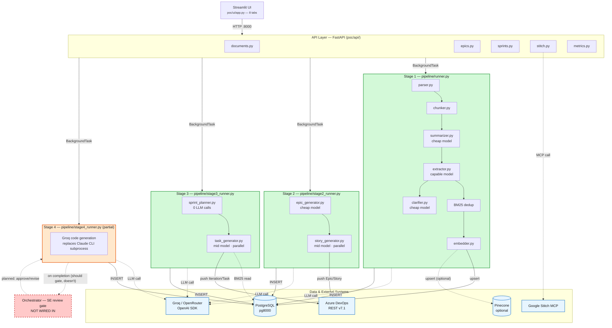

# StackForge — System Architecture Diagram

> **Scope:** current implementation on branch `poc/stage-4` (2026-08-11). Every solid box below is a real module in `poc/`. The single red dashed box is the one piece of the current flow that is designed but **not wired in yet** — included on purpose so this diagram stays honest instead of only showing the happy path.
>
> Renders natively on GitHub/GitLab and in VS Code's Markdown preview (no server, no plugin required — that's why Mermaid was chosen over the Excalidraw diagrams in `Exiladraw/`, which need a running canvas server).

---

## Diagram

---

## Component Legend

| Box | File(s) | What it does |
|---|---|---|
| Streamlit UI | `poc/ui/app.py` | 8-tab demo UI. Never touches the DB directly — everything goes through FastAPI. |
| API Layer | `poc/api/routes/*.py` | Request parsing + response shaping only. Dispatches long work to `BackgroundTasks` and calls into the pipeline layer directly (no queue in the POC). |
| Stage 1 | `parser → chunker → summarizer → extractor → BM25 dedup → embedder`, `clarifier` | Turns raw documents into structured requirements + a searchable chunk store. `summarizer`/`clarifier` use the cheap model; `extractor` uses the capable model. |
| Stage 2 | `epic_generator → story_generator` | Groups requirements into epics (cheap model, titles only), then writes user stories per epic in parallel (mid model, scoped context). |
| Stage 3 | `sprint_planner → task_generator` | Bin-packs stories into sprints (pure algorithm, $0), then decomposes each story into dev tasks in parallel (mid model + free BM25 context). |
| Stage 4 | `stage4_runner` → Groq codegen | **Partial.** Generates code for a task directly via Groq. Not yet connected to a real coding-agent daemon, no codebase RAG, no sub-agent decomposition. |
| Orchestrator | *(not implemented)* | **Gap.** Should intercept Stage 4 completion and hold for a senior-engineer approval via Lark before anything is marked done. Today, nothing stops the pipeline here. |
| PostgreSQL | `poc/db.py`, `pg8000` | System of record — requirements, epics, stories, sprints, tasks, all `stageN_metrics` tables. |
| Groq / OpenRouter | `pipeline/llm_utils.py` | Single client factory every pipeline module imports from. Model tier (cheap/mid) selected per call site, not per provider. |
| Pinecone | `rag/pinecone_client.py` | Optional semantic search layer, merged with BM25 via Reciprocal Rank Fusion. Falls back to BM25-only if unset. |
| Azure DevOps | `pipeline/ado_client.py` | REST v7.1. Epics/Stories from Stage 2, Iterations/Tasks from Stage 3. Idempotent — safe to re-push. |
| Google Stitch MCP | `pipeline/stitch_designer.py` | Generates UI design screens from `design.md`, outside the main 6-stage pipeline. |

---

## How to Explain This Diagram

This is the **technical** version — use it in an engineering discussion, not the first pitch. Different framing than a plain-English overview: here, the *layer boundaries* and the *dashed gap* are the point.

1. **Start at the boundary, not the middle.** "UI never touches the database — everything routes through FastAPI, and FastAPI never contains business logic, it just dispatches into the pipeline layer." That one sentence explains why the diagram has three horizontal bands before you've named a single file.

2. **Trace one request end-to-end.** Pick Stage 2: a story gets pushed from the UI → FastAPI route → `stage2_runner.py` → `epic_generator.py` → `story_generator.py` → Postgres + ADO. Walking one real path is more convincing than describing all four stages abstractly.

3. **Point at the dashed arrows and name them out loud.** Every dashed line is an LLM call — call out that Stage 1/2/3 dashed lines go to the *same* `LLM` box but at different model tiers, and that's the entire cost-routing story sitting visibly on the diagram: cheap model for classification steps, mid model for generation steps.

4. **Land on the red dashed box last, not first.** The Orchestrator gap is the most important box on this diagram precisely because it's the only one not solid — say directly: "Stage 4 completes and nothing stops for review right now. This box is designed, not built." That's a stronger signal of engineering maturity than hiding it in prose.

5. **If asked "why not one big service"** — point at the layer separation and say it mirrors the production target on purpose: Streamlit/FastAPI/pipeline here maps directly to Next.js/Go backend/daemon in the real Multica architecture, so nothing here gets thrown away when Multica is cloned — it gets replaced layer-for-layer.